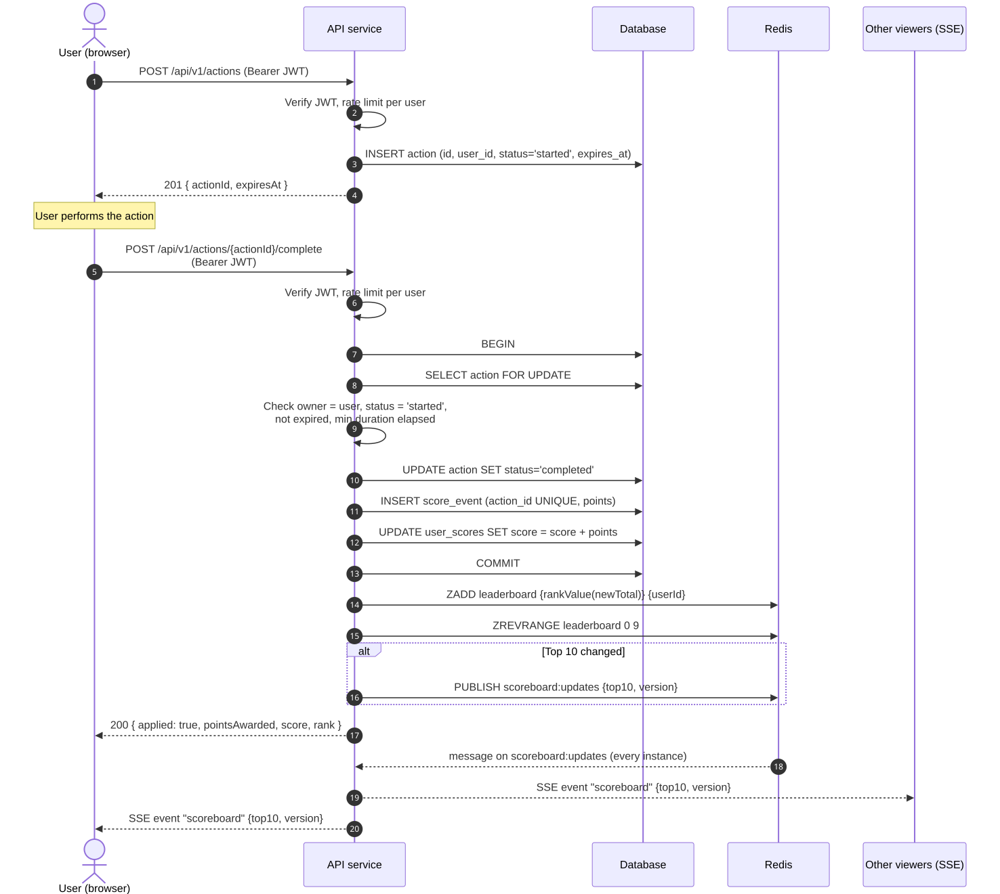
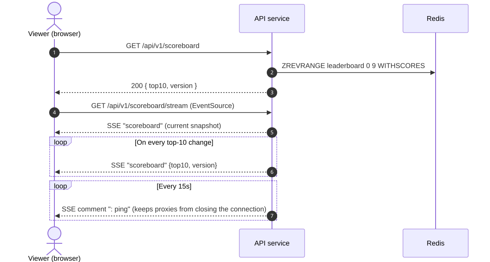

# Problem 6: Architecture

> ⏰ Duration: You should not spend more than **8 hours** on this problem.
> *Time estimation is for internship roles, if you are a software professional you should spend significantly less time.*

# Task

Write the specification for a software module on the API service (backend application server).

1. Create a documentation for this module on a `README.md` file.
2. Create a diagram to illustrate the flow of execution.
3. Add additional comments for improvement you may have in the documentation.
4. Your specification will be given to a backend engineering team to implement.

### Software Requirements

1. We have a website with a score board, which shows the top 10 user's scores.
2. We want live update of the score board.
3. User can do an action (which we do not need to care what the action is), completing this action will increase the user's score.
4. Upon completion the action will dispatch an API call to the application server to update the score.
5. We want to prevent malicious users from increasing scores without authorisation.

---

# Solution: Live Scoreboard Module, Specification

> **Audience:** backend engineering team implementing the module.
> **Status:** proposal for implementation. **[Decision]** marks a deliberate choice. **[Open question]** marks something product must answer before or during implementation.
> **Diagrams:** click any diagram to open it full size.

## Table of contents

1. [Overview](#1-overview)
2. [Assumptions](#2-assumptions)
3. [Architecture](#3-architecture)
4. [Flow of execution](#4-flow-of-execution)
5. [API specification](#5-api-specification)
6. [Data model](#6-data-model)
7. [Security: preventing unauthorised score increases](#7-security-preventing-unauthorised-score-increases)
8. [Live updates](#8-live-updates)
9. [Consistency, failure handling and scaling](#9-consistency-failure-handling-and-scaling)
10. [Configuration](#10-configuration)
11. [Observability](#11-observability)
12. [Testing requirements and implementation checklist](#12-testing-requirements-and-implementation-checklist)
13. [Improvements and further comments](#13-improvements-and-further-comments)

---

## 1. Overview

The Scoreboard module lives in the existing API service. It handles:

| Responsibility | Requirement |
|---|---|
| Serving the top 10 users by score | R1 |
| Pushing live updates of the top 10 to connected browsers | R2 |
| Accepting score increases when a user completes an action | R3, R4 |
| Making sure a score only increases for a genuine, authorised, completed action | R5 |

### Where the trust comes from (R5)

In the task, the action happens in the browser and then "dispatches an API call to the application server to update the score". If that call carried the score, or only said "I finished an action", any user could send it as often as they like from a script, with a valid login or without one. The server never sees the action itself. It only sees HTTP requests about it.

What the server does control is its own data, so in this design only the server can create something that is worth points:

1. When the user starts an action, the server stores an action record and returns its id.
2. When the user reports the action as done, the request names that id and nothing else. The server loads the record and checks that it belongs to the caller, is still open and has not expired. It closes the record in the same transaction that adds the points.
3. The number of points comes from server configuration.

A script can still call the two endpoints, and §7 covers what limits that. It cannot make up a score, reuse an old completion, or add points to someone else's account.

## 2. Assumptions

- Users are already authenticated by the API service (e.g. a JWT access token issued by an existing auth module). This module consumes the authenticated `userId`; it does not implement login.
- The action itself is opaque to us (R3), but the server can record when it starts and when the client reports it complete. The points awarded per action are a server-side constant (or a server-side lookup by action type), not client input.
- Scores only increase. There is no decrease or reset in scope.
- The scoreboard is global (one board, all-time). Seasonal/regional boards are listed under [improvements](#13-improvements-and-further-comments).
- The API service runs as several stateless instances behind a load balancer, so live updates must work across instances.
- Expected scale for sizing: up to about 1M users, 1k score updates/sec at peak and 50k concurrent scoreboard viewers. §9 covers growth beyond that.

## 3. Architecture

[](diagrams/01-architecture.svg)

<sub>Click the diagram to open it full size. Source: [`diagrams/01-architecture.mmd`](diagrams/01-architecture.mmd)</sub>

| Component | Responsibility |
|---|---|
| **Auth middleware** | Verifies the access token, attaches `userId`. Existing component, reused. |
| **Action controller** | Starts an action for the user and issues a single-use `actionId`. |
| **Score controller** | Validates a completion claim and awards points. |
| **Scoreboard controller** | Returns the current top 10 (initial page load and fallback). |
| **Live stream controller** | Holds Server-Sent Events connections and forwards top-10 changes. |
| **Scoreboard service** | All business logic: validation rules, DB transaction, Redis update, change detection and publishing. |
| **Relational DB** | Source of truth: users' totals, actions, and an append-only score ledger. |
| **Redis** | Leaderboard (`ZSET`) and cross-instance broadcast (pub/sub). Can be rebuilt entirely from the DB. |

**[Decision] Redis sorted set for ranking.** `ZREVRANGE leaderboard 0 9` is O(log N + 10), whereas `ORDER BY score DESC LIMIT 10` on a hot, frequently updated table becomes a bottleneck under concurrent writes. The DB stays the source of truth; Redis is a cache that can be rebuilt (§9).

**[Decision] Server-Sent Events (SSE) for live updates.** The board only sends data from the server to the browser, which is what SSE was made for. It is a normal HTTP response that stays open, so proxies and the load balancer handle it without extra setup, and the browser's `EventSource` reconnects by itself when the connection drops. WebSockets would work too, but they need an upgrade handshake and reconnect code that we would write ourselves, for messages that only travel one way. Polling is the easiest to build, but 50k viewers polling once a second means 50k requests per second, and almost all of them return the same top 10. If the board later needs messages from the browser, WebSockets can replace SSE without changing the REST endpoints in §5.

## 4. Flow of execution

### 4.1 Happy path: completing an action and updating the board

[](diagrams/02-happy-path.svg)

<sub>Click the diagram to open it full size. Source: [`diagrams/02-happy-path.mmd`](diagrams/02-happy-path.mmd)</sub>

### 4.2 Rejected claim

[](diagrams/03-rejected-claim.svg)

<sub>Click the diagram to open it full size. Source: [`diagrams/03-rejected-claim.mmd`](diagrams/03-rejected-claim.mmd)</sub>

### 4.3 Viewer opening the scoreboard

[](diagrams/04-viewer-subscribe.svg)

<sub>Click the diagram to open it full size. Source: [`diagrams/04-viewer-subscribe.mmd`](diagrams/04-viewer-subscribe.mmd)</sub>

## 5. API specification

Base path: `/api/v1`. All bodies are JSON. Authenticated endpoints require `Authorization: Bearer <access token>`.

### 5.1 `POST /actions`: start an action

| | |
|---|---|
| Auth | Required |
| Body | `{ "type": "default" }` (optional; reserved for future action types) |
| Rate limit | e.g. 30/min per user |

**201 Created**
```json
{ "actionId": "01J9Z6M7K8Q2...", "expiresAt": "2026-10-12T10:05:00Z" }
```

`actionId` is an opaque, unguessable ID (UUIDv7/ULID, ≥ 122 bits of randomness). A user may have at most `MAX_OPEN_ACTIONS` (e.g. 3) actions in `started` state; extra requests get `429`.

### 5.2 `POST /actions/{actionId}/complete`: claim the score

| | |
|---|---|
| Auth | Required |
| Body | None. The request has no `points` or `score` field, and the server ignores one if sent. |
| Rate limit | e.g. 30/min per user, 5/sec burst |

**200 OK**
```json
{ "applied": true, "pointsAwarded": 10, "score": 1240, "rank": 7 }
```
`rank` is `null` when the user is outside the tracked range.

**Idempotency [Decision]:** the single-use `actionId` doubles as the idempotency key, so no separate `Idempotency-Key` header or storage is needed. If the client retries `complete` for an action that is already completed (e.g. after a network timeout), the server returns `200` with the original `pointsAwarded` (read from `score_events`), the current `score`/`rank`, and `"applied": false`. Points are never awarded twice.

### 5.3 `GET /scoreboard`: current top 10

| | |
|---|---|
| Auth | Not required (public board). **[Open question]** confirm the board is public. |
| Cache | `Cache-Control: no-store` (it changes live) |

**200 OK**
```json
{
  "version": 18342,
  "updatedAt": "2026-10-12T10:00:03Z",
  "entries": [
    { "rank": 1, "userId": "u_123", "displayName": "alice", "score": 5120 },
    { "rank": 2, "userId": "u_456", "displayName": "bob",   "score": 4980 }
  ]
}
```
Only public fields are returned (`displayName`, never email or other PII).

### 5.4 `GET /scoreboard/stream`: live updates (SSE)

Response `Content-Type: text/event-stream`. On connect, the server immediately sends the current snapshot, then one event per change:

```
id: 18343
event: scoreboard
data: {"version":18343,"updatedAt":"...","entries":[...]}

: ping
```

- Each event carries the full top 10 (about 1 KB). Clients replace their state with it, so a missed event cannot leave them inconsistent.
- Clients ignore events whose `version` is lower than the one they already have.
- On reconnect, the server sends the current snapshot regardless of `Last-Event-ID`.

### 5.5 Error format

```json
{ "error": { "code": "ACTION_EXPIRED", "message": "This action has expired" } }
```

| HTTP | Code | Meaning |
|---|---|---|
| 400 | `VALIDATION_ERROR` | Malformed request |
| 401 | `UNAUTHENTICATED` | Missing/invalid/expired token |
| 404 | `ACTION_NOT_FOUND` | Unknown action, or action of another user |
| 409 | `ACTION_EXPIRED` | Completed after `expiresAt` |
| 422 | `ACTION_TOO_FAST` | Completed faster than humanly/technically possible |
| 429 | `RATE_LIMITED` | Too many requests (`Retry-After` header set) |
| 503 | `SCOREBOARD_UNAVAILABLE` | Redis down and DB fallback failed |

## 6. Data model

[](diagrams/05-data-model.svg)

<sub>Click the diagram to open it full size. Source: [`diagrams/05-data-model.mmd`](diagrams/05-data-model.mmd)</sub>

- `score_events` is an append-only ledger. Its `UNIQUE(action_id)` constraint guarantees that one action is scored at most once, even if two application checks race.
- `user_scores.score` is a denormalised total, updated in the same transaction. It must always equal `SUM(score_events.points)` per user (verified by a periodic reconciliation job, §9).
- Index: `actions (user_id, status)` for the open-action limit.

**Redis keys**

| Key | Type | Content |
|---|---|---|
| `leaderboard` | ZSET | member = `userId`, score = composite rank value (see tie-breaking) |
| `scoreboard:version` | STRING | monotonically increasing counter (`INCR`) |
| `scoreboard:updates` | pub/sub channel | JSON snapshot of the top 10 |
| `ratelimit:{userId}:{route}` | STRING with TTL | rate-limit counters |

**Tie-breaking [Decision]:** users with equal scores are ranked by who reached that score first (`user_scores.score_reached_at`). Redis stores ZSET scores as IEEE-754 doubles, which are exact only up to 2^53, so a composite value must fit in 53 bits:

```
rankValue = score * 2^32 + (2^32 - 1 - secondsSince(EPOCH))
```

32 bits of seconds cover about 136 years, leaving 21 bits for the score, so this is exact only while scores stay below 2^21 (~2.1M). If scores can grow beyond that, store the plain score in the ZSET instead, fetch the top 10 plus every user tied with the 10th entry (`ZRANGE leaderboard <score10> +inf BYSCORE`), and order the ties by `score_reached_at` from the DB. **[Open question]** confirm the tie rule and the expected maximum score with product.

## 7. Security: preventing unauthorised score increases

Threat model: an attacker with a valid account (or none) tries to raise their own or someone else's score without genuinely completing actions.

| # | Threat | Mitigation |
|---|---|---|
| 1 | Calling the API without being logged in | JWT required on all write endpoints; verify signature, `exp`, `aud`, `iss`. |
| 2 | Raising another user's score | `userId` comes only from the verified token, never from the body or URL. The action must belong to that user. |
| 3 | Sending an arbitrary number of points | The request has no points field. The server decides the points per action type. |
| 4 | Replaying the same completion request | Single-use `actionId`: status transition `started → completed` under row lock + `UNIQUE(action_id)` in the ledger. |
| 5 | Calling *complete* without ever starting an action | Completion requires a server-issued `actionId` that exists in the DB. |
| 6 | Forging/guessing action IDs | IDs are random (≥ 122 bits) and checked against the DB and owner. |
| 7 | Scripting thousands of start/complete pairs | Per-user and per-IP rate limits; `MAX_OPEN_ACTIONS`; `MIN_ACTION_DURATION`; daily points cap per user (`MAX_POINTS_PER_DAY`). |
| 8 | Stolen token | Short-lived access tokens (≤ 15 min) + refresh tokens; HTTPS only; tokens not stored in `localStorage` where avoidable. |
| 9 | Mass-scraping or DoS of the stream endpoint | Connection limit per IP, idle timeout, gateway rate limiting. |
| 10 | Tampering hidden in logs/audit | Every award recorded in `score_events` with IP and user agent; anomalies (§11) flagged for review, never silently dropped. |

**Limitation the team should accept:** the action happens in the browser, so a determined attacker can still script the real start and complete calls at human speed. Rows 5 to 7 make cheating slow, capped and visible, but they cannot prove the action happened. If the server can verify the action itself (for example a puzzle answer, a game result or a payment), that check should replace the time-based ones. See improvement #1.

## 8. Live updates

1. After a successful award, the service updates the ZSET and reads the new top 10.
2. It compares the new top 10 with the last published snapshot, which is cached in memory per instance and in Redis. It runs `INCR scoreboard:version` and `PUBLISH` only when the members, order or scores in the top 10 changed. Most updates come from users outside the top 10 and cause no broadcast.
3. Every API instance subscribes to `scoreboard:updates` and writes the event to all of its open SSE connections.
4. **Coalescing [Decision]:** broadcasts are throttled to at most one every `BROADCAST_INTERVAL_MS` (e.g. 250 ms). If several changes occur within that window, only the latest snapshot is sent. This bounds fan-out cost at `viewers × 4 msg/s` regardless of write volume.
5. Clients render the received top 10 as is, with no merging logic.

## 9. Consistency, failure handling and scaling

| Scenario | Behaviour |
|---|---|
| DB transaction fails | Nothing is awarded; the client gets 5xx and may safely retry `complete` with the same `actionId`. |
| DB commits but the Redis update fails | The response still succeeds (DB is the truth). The failure is logged and the user is queued for a Redis resync. `ZADD` writes the absolute total read from the DB, so a retried or late update still leaves the right value. |
| Redis unavailable for reads | `GET /scoreboard` falls back to `SELECT ... ORDER BY score DESC LIMIT 10` from the DB (index on `user_scores(score DESC)`), with a short in-memory cache. |
| Redis data lost | A rebuild job reloads `leaderboard` from `user_scores`. |
| Drift between ledger and totals | Nightly reconciliation compares `SUM(score_events.points)` to `user_scores.score` and alerts on mismatch. |
| Instance restarts | SSE clients reconnect automatically to another instance and receive the current snapshot. |
| Abandoned actions | A periodic job (or lazy check) marks `started` actions past `expires_at` as `expired`. |

**Scaling notes**
- The API is stateless; add instances behind the load balancer. SSE connections are long-lived, so ensure the LB idle timeout exceeds the ping interval and that connection-based (not request-based) balancing is acceptable.
- One Redis primary handles the stated load. If `ZADD` volume grows very large, writes can be batched per 100 ms.
- Concurrent awards for the same user are serialised by the row lock on `user_scores` / `actions`; awards for different users do not contend.

## 10. Configuration

| Variable | Example | Description |
|---|---|---|
| `POINTS_PER_ACTION` | `10` | Points awarded per completed action (or a per-type table) |
| `ACTION_TTL_SECONDS` | `600` | Time allowed between start and complete |
| `MIN_ACTION_DURATION_MS` | `2000` | Minimum plausible time to complete an action |
| `MAX_OPEN_ACTIONS` | `3` | Concurrent `started` actions per user |
| `MAX_POINTS_PER_DAY` | `5000` | Daily cap per user |
| `RATE_LIMIT_*` | `30/min` | Per-route, per-user and per-IP limits |
| `SCOREBOARD_SIZE` | `10` | Number of entries shown |
| `BROADCAST_INTERVAL_MS` | `250` | Minimum interval between live broadcasts |
| `SSE_PING_INTERVAL_MS` | `15000` | Keep-alive interval |

## 11. Observability

- Metrics: awards/sec, rejected completions by error code, broadcast count, open SSE connections per instance, Redis and DB latency, Redis resync queue size.
- Structured logs: every award and every rejection with `userId`, `actionId`, IP, reason and request ID. Tokens are never logged.
- Alerts: a spike in `ACTION_TOO_FAST` or `RATE_LIMITED` for one user or IP, a reconciliation mismatch, Redis down, a high SSE disconnect rate.
- Abuse review: an admin report of users with abnormal points per hour, used for manual review or automatic suspension.

## 12. Testing requirements and implementation checklist

The implementation should include at least:

- Unit: validation rules (owner, status, expiry, min duration, daily cap), top-10 change detection, tie-breaking.
- Integration, with a real DB and Redis:
  - start → complete awards points exactly once;
  - a second completion of the same action returns the original result with `applied: false` and awards nothing;
  - completing another user's action returns 404;
  - a client-supplied `points` field has no effect;
  - 50 parallel completions of the same action award points exactly once;
  - Redis failure after commit is recovered by resync.
- Live updates: two SSE clients connected to two different instances both receive a change; no event is sent when a non-top-10 user scores.
- Load test: target throughput from §2 with p99 latency for `complete` < 150 ms.

### Implementation checklist

- [ ] Migrations for `actions`, `score_events` (`UNIQUE(action_id)`), `user_scores` (+ index on `score DESC`)
- [ ] `POST /actions` and `POST /actions/{id}/complete` with the checks in §4.2, in one DB transaction
- [ ] Redis: `leaderboard` ZSET, `scoreboard:version`, pub/sub channel, rate-limit counters
- [ ] `GET /scoreboard` with DB fallback; `GET /scoreboard/stream` (SSE) with snapshot-on-connect, 15 s ping, 250 ms coalescing
- [ ] Jobs: expire stale actions, Redis resync/rebuild, nightly ledger reconciliation
- [ ] Metrics, structured logs and alerts from §11
- [ ] The tests above, in particular the concurrent-completion test

## 13. Improvements and further comments

1. Verify the action on the server whenever possible. This would help more than anything else on this list. If the server can validate the action, or a trusted backend reports it through a signed webhook, points should come from that verified event and not from a browser call. The time and rate checks in this spec then become a second line of defence.
2. Bot and abuse protection: add a CAPTCHA / proof-of-work or device-attestation check on `POST /actions` after suspicious behaviour, and anomaly detection on the `score_events` ledger (points/hour vs. population percentiles).
3. Signed action tokens: instead of storing every started action, `POST /actions` could return a short-lived HMAC-signed token (`userId`, `actionId`, `iat`). A DB write would then only be needed on completion (the unique `action_id` still prevents replay). This trades some flexibility (e.g. `MAX_OPEN_ACTIONS`) for fewer writes, which suits very high volumes.
4. Event-driven decoupling: publish a `ScoreAwarded` event to a queue or stream (Kafka, SQS, Redis Streams) with the transactional outbox pattern. Leaderboard updates, broadcasts, notifications and analytics then become independent consumers, and no update is lost if Redis is briefly down.
5. Personal rank: besides the top 10, show "your rank" and the users around you (`ZREVRANK` + `ZREVRANGE`), streamed only to that user.
6. Multiple boards: daily/weekly/seasonal or regional leaderboards using one ZSET per period (`leaderboard:2026-W41`) with TTLs.
7. Privacy: let users opt out of appearing publicly; show display names only; consider a moderation step for offensive display names, since they are broadcast live.
8. Very large audiences: every viewer receives the same data, so at millions of viewers the snapshot can go through a CDN or edge pub/sub product, or clients can poll a CDN-cached `GET /scoreboard` every 1 to 2 s.
9. API contracts: publish an OpenAPI document for the REST endpoints and a schema for SSE payloads, so frontend and backend can evolve independently.

### Open questions for product

- Is the scoreboard public or only visible to logged-in users?
- How many points does an action give? Is it fixed or does it depend on the action type?
- What is a realistic minimum duration for an action, and should there be a daily cap?
- How should ties be ordered?
- Is there a reset/season concept?
